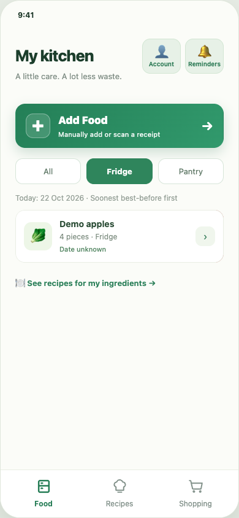
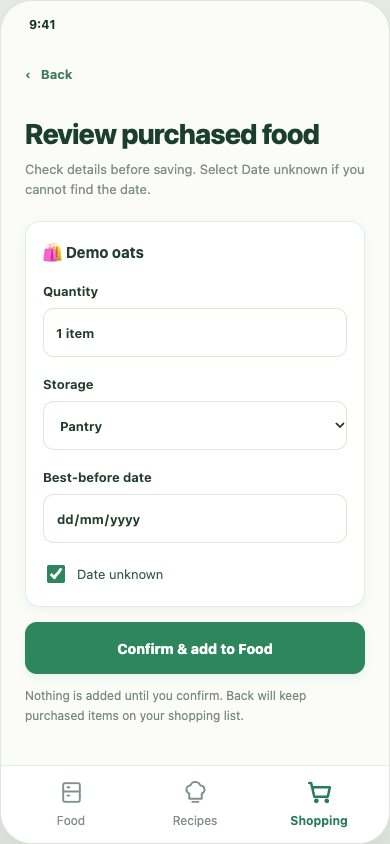
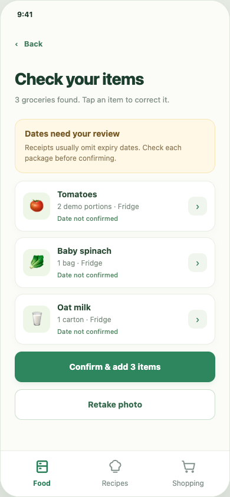
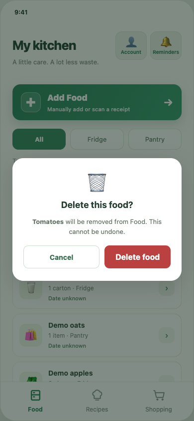

# FreshLoop — Food Waste Assistant

An HCI coursework prototype exploring how households can keep food visible, review shopping decisions and correct food-entry suggestions with less manual effort.

## Motivation

Food information is spread across storage locations, shopping decisions and meal planning. FreshLoop connects inventory, purchase review and recipe suggestions in one mobile-style interface. It explores an interaction design problem; it does not demonstrate a measured reduction in food waste.

## My contribution

In Semester 2, 2026, I designed a questionnaire, conducted one user interview and two think-aloud sessions, translated needs into functional requirements, and tested the team's Hi-Fi prototype. In early/Lo-Fi design, I contributed the food-management concept and proposed receipt-assisted entry to reduce manual work. I reviewed usability and gave technical implementation suggestions rather than independently implementing the entire application.

## Research and design

The process connects questionnaire/interview design → needs-to-function mapping → team prototype → interaction testing → think-aloud feedback.

- **Need → concept:** easier food entry motivated my proposal to recognize purchases from receipts and add them to the kitchen inventory. The current receipt workflow is a simulation, not implemented OCR.
- **Interaction review → recommendation:** for a mobile app used while holding a phone, I recommended bottom navigation and supplied usability/technical refinement suggestions. The prepared prototype has bottom navigation; no measured one-handed-use improvement is claimed.
- **Evaluation → implementation suggestions:** I tested the Hi-Fi system and translated potential users' think-aloud feedback into technical recommendations. The counts above describe my own sessions; the team total is not asserted.

The current runnable demonstration also includes later portfolio repairs and browser-local state/account handling. Its software regression tests are separate from the original coursework evaluation. Raw participant records and confidential submissions are excluded.

## Implemented functionality

- Browse/filter food inventory, add items manually and edit quantity, date and storage.
- Review purchased food, explicitly confirm changes and select an unknown date.
- Preview a local image and correct a fixed simulated receipt-item list.
- Browse rule-based recipe suggestions and add missing ingredients to shopping.
- Confirm deletion and return through contextual navigation; save fictional data in browser storage.

## Screenshots

Genuine captures of the prepared application using synthetic data; not original participant-session images.

| Inventory and storage filter | Review before adding purchases |
|---|---|
|  |  |

| Correct simulated receipt items | Confirm a destructive action |
|---|---|
|  |  |

## Technology and local setup

HTML, CSS and vanilla JavaScript, using local/session storage without a backend. Open `index.html` directly, or use Node.js 22+ for a stable localhost origin:

```sh
node scripts/serve.cjs
```

Open `http://127.0.0.1:8104` and choose **Continue as guest**, or register a fictional account with a disposable password. Guest data is temporary; registered demo data is browser-local. Use a fresh browser profile. No runtime dependency installation or build is needed.

See [technical notes](TECHNICAL_NOTES.md), [testing](TESTING.md) and [test results](TEST_RESULTS.md). Eight automated browser checks passed for inventory, editing, shopping/purchase, simulated receipt correction, recipes, deletion/navigation and persistence. These checks do not establish human usability outcomes.

## Limitations and research direction

Receipt/camera behavior is simulated: no OCR or ML model is included. Recipe ranking is rule based, not AI, and does not establish ingredient sufficiency or food safety. Browser-local accounts are a demonstration rather than production authentication. Touchscreen, accessibility and broader browser testing remain limited. A future Human-AI Interaction question is how review/correction and uncertainty cues influence appropriate trust; that experiment has not been conducted here.

## Team and attribution

Developed collaboratively for University of Sydney INFO3315 in Semester 2, 2026. Credit is given to the project team collectively; my research, early concepts and evaluation role is described above. Prototype implementation and screens are shared team work. Later portfolio repairs and software tests are separate from original coursework contributions. No blanket public license is applied.
